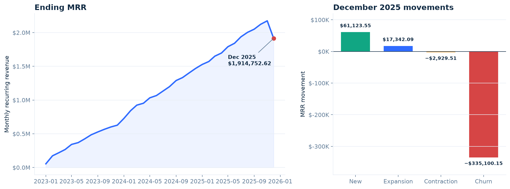

# SaaS Revenue Intelligence

[](https://github.com/VijayChamakuri/saas-revenue-intelligence/actions/workflows/ci.yml)
[](pyproject.toml)
[](LICENSE)

A recurring-revenue close can look like a customer problem when a date in the extract is wrong.

I built a warehouse, a metric contract, and two dashboards on a seeded company of 1,200 accounts, from January 2023 through December 2025. Synthetic data stands in for a billing extract I do not have.

The monthly recurring revenue (MRR) bridge matches to the cent in every month. December 2025 still falls by $259,564.02, and 120 of the 132 cancellations that month are dated 2025-12-31.



| Measure | Value | Scope |
|---|---:|---|
| Ending MRR | $1,914,752.62 | December 2025 |
| Net new MRR | −$259,564.02 | December 2025 |
| Churned MRR | $335,100.15 | December 2025 |
| Gross revenue retention | 84.5% | December 2025 |
| Net revenue retention | 85.3% | December 2025 |
| Cancellations on 2025-12-31 | 120 of 132 | December end dates |
| Bridge variance | $0.00 | All 36 months |
| Failed-payment exposure | $1,461,681.54 | All 36 months, 638 invoices |

Ending MRR is recurring revenue still active at month end. Net new MRR adds new, expansion, and reactivation, and subtracts contraction and churn. Gross revenue retention keeps expansion out of the numerator; net revenue retention includes it. The 132 cancellations are subscription end dates. That is not the 129 customers whose MRR went to zero in the same month.

The bridge matches, so the December drop is in the ledger. I would not report it as a change in customer behavior: the generator clips a cancellation to 2025-12-31 when the drawn end date falls past the window, and the median earlier month has 4 cancellations. The failed-payment total is a different figure, summed across every month, and it is 3.6% of the $40,862,284.26 billed in the window. December alone is $53,721.83. Full ratios, the churn score, and the forecast errors are in [docs/RESULTS.md](docs/RESULTS.md).

## How it works

### A seeded company, with the defects written down

[`src/generation/generate.py`](src/generation/generate.py) builds the company from seed `20260831`. Failed payments, refunds, and higher cancellation odds for small business are written into the generator on purpose. Two other patterns are just the dates: invoices are the first of the month while contracts start mid-month, which is why all 969 exceptions are `contract_date_conflict`, and cancellations that would fall after the window are clipped to 2025-12-31. The rules are listed in [docs/data_generation_rules.md](docs/data_generation_rules.md).

### MRR is a balance, then a label

For each customer, product, and plan, the month's MRR is the latest subscription event before month end ([`int_subscription_monthly_mrr.sql`](dbt/models/intermediate/int_subscription_monthly_mrr.sql)). The dbt (data build tool) movement model compares that balance with the previous month:

```sql
select closing_mrr - opening_mrr as mrr_change,
  case
    when opening_mrr = 0 and closing_mrr > 0
      and coalesce(prior_active_months, 0) = 0
      then 'new'
    when opening_mrr = 0 and closing_mrr > 0
      then 'reactivation'
    when opening_mrr > 0 and closing_mrr = 0
      then 'churn'
    when closing_mrr > opening_mrr then 'expansion'
    when closing_mrr < opening_mrr then 'contraction'
    else 'no_change'
  end as movement_type
from movement_base
```

The lag that sets opening MRR is in [`fct_mrr_movement.sql`](dbt/models/marts/revenue/fct_mrr_movement.sql). [`mart_mrr_bridge.sql`](dbt/models/marts/revenue/mart_mrr_bridge.sql) checks that opening plus new, expansion, and reactivation, minus contraction and churn, equals closing, which it does to the cent, and [`mart_revenue_kpis.sql`](dbt/models/marts/revenue/mart_revenue_kpis.sql) turns the bridge into the retention ratios.

### Invoices are checked against payments and the contract

[`fct_billing_reconciliation.sql`](dbt/models/marts/finance/fct_billing_reconciliation.sql) is one row per invoice: billed, paid, failed, refunded, recognized. [`mart_finance_exceptions.sql`](dbt/models/marts/finance/mart_finance_exceptions.sql) unions eight rules. On this extract only one rule fires, `contract_date_conflict`, and it fires 969 times. The other seven are still in the model so a bad file fails the build instead of disappearing.

### The churn score cannot see the future

[`src/modeling/churn.py`](src/modeling/churn.py) scores one account snapshot per date. The label is a cancellation in the next 90 days, and the features are built from account state that already exists at the snapshot, plus noise, so the score never reads the cancellation date. Training, calibration, and the holdout are cut by date, and the contact threshold is chosen only on the calibration window. On the holdout the logistic score has an area under the receiver operating characteristic curve (ROC-AUC) of 0.633, the cost-selected threshold pays −$1,705, and the split, the costs, and the boosting challenger are in [docs/METHODOLOGY.md](docs/METHODOLOGY.md).

### Both dashboards read the marts

[`metrics/semantic_layer.yml`](metrics/semantic_layer.yml) names every governed metric. [`src/validation/semantic_layer.py`](src/validation/semantic_layer.py) recomputes each one in DuckDB and compares it with the mart: 361 metric-months, all tied and inside their bounds. The offline dashboard ([`dashboard/index.html`](dashboard/index.html)) and the Tableau workbook are built from those same marts, and both are tied back: 128 of 128 dashboard measures ([`dashboard/validation_evidence.csv`](dashboard/validation_evidence.csv)) and 288 of 288 Tableau KPI values ([`tableau/validation_evidence.csv`](tableau/validation_evidence.csv)).

The published workbook is [on Tableau Public](https://public.tableau.com/app/profile/vijay.chamakuri/viz/SaaSRevenueIntelligenceMRRRetentionBillingControls/Executiveoverview), with screenshots for [executive](tableau/screenshots/01_executive_overview.png), [revenue](tableau/screenshots/02_revenue_retention.png), [risk](tableau/screenshots/03_customer_risk.png), and [finance](tableau/screenshots/04_finance_controls.png).

## Design decisions

| Choice | Why | Cost |
|---|---|---|
| Classify the movement from the monthly balance, not from the event name | The bridge has to add up. An event row can disagree with the balance that is still open. | New versus reactivation depends on whether that customer, product, and plan was active before. |
| Check the metric YAML in DuckDB, rather than running MetricFlow | The same check also ties the workbook and the Tableau extract. | This is not a dbt Semantic Layer deployment. MetricFlow is installed with dbt and is not the runner. |
| Split by time, and pick the threshold on a middle window | The label is a future 90 days. A random split would train on the outcome. | Fewer training rows. The 4% threshold is not refit on the holdout. |
| Ship logistic regression; keep gradient boosting as the challenger | The holdout needs a probability. The challenger's ROC-AUC is 0.502, against 0.633 for logistic regression. | A linear model misses interactions the features do not already encode. |
| Generate the Tableau workbook from the marts | The extract can be diffed, and 288 KPI values are checked against the marts. | The layout is code, not a hand-built workbook. |
| Use DuckDB as the warehouse | The pipeline runs without cloud credentials. | Nothing here is a BigQuery or Snowflake proof. |

## Evaluation

`make pipeline` builds the warehouse and then runs Ruff, mypy, and pytest. The suite is 103 tests, and they pass at the end of that command. Pytest skips the warehouse checks if you run it before the build. dbt parses 37 models. Three intermediate models are ephemeral, so `dbt build` runs 114 resources: 34 models and 80 data tests, all passing, and source freshness passes for all 22 sources. Line coverage of `src` is 67%.

- [`tests/test_generation.py`](tests/test_generation.py) — the seed rebuilds the same rows, and those rows pass the source checks. 2 tests.
- [`tests/test_source_validation.py`](tests/test_source_validation.py) — bad keys, bad dates, and duplicate usage events are rejected. 4 tests.
- [`tests/test_adversarial_sources.py`](tests/test_adversarial_sources.py) — planted defects fail the contracts; the clean file passes. 8 tests.
- [`tests/test_semantic_layer.py`](tests/test_semantic_layer.py) — the metric contract ties to the marts, and a bridge that does not roll forward is caught. 11 tests.
- [`tests/test_run_audit.py`](tests/test_run_audit.py) — a failed check closes the run as failed. 3 tests.
- [`tests/dashboard/test_dashboard.py`](tests/dashboard/test_dashboard.py) — dashboard measures, including the warehouse tie-out. 8 tests.
- [`tests/test_excel_workbook.py`](tests/test_excel_workbook.py) — sheets, 854 formulas, protection, and which cells can be edited. 8 tests.
- [`tests/test_tableau_package.py`](tests/test_tableau_package.py) — four dashboards, the synthetic-data notice, and the KPI tie-out. 7 tests.
- [`tests/modeling/test_churn.py`](tests/modeling/test_churn.py) — the time split and the cost threshold. 4 tests.
- [`tests/modeling/test_diagnostics.py`](tests/modeling/test_diagnostics.py) — calibration, drift, and forecast error. 7 tests.
- [`tests/modeling/test_forecast.py`](tests/modeling/test_forecast.py) — the backtest uses only months before the origin. 4 tests.
- [`tests/analytics/test_survival_crosscheck.py`](tests/analytics/test_survival_crosscheck.py) — a known Kaplan-Meier example. 2 tests.
- [`tests/test_ba_artifacts.py`](tests/test_ba_artifacts.py) — the business-analysis docs cite real files and do not claim a real company. 35 tests.
- [`dbt/tests/`](dbt/tests/) — 8 singular SQL tests, inside the 80 data tests. The bridge test is [`assert_mrr_bridge_rolls_forward.sql`](dbt/tests/assert_mrr_bridge_rolls_forward.sql).

## Limitations

Every number describes this generated company. It is not a real book of business, and it is not evidence that a retention program would pay for itself. The December cliff and the 969 contract-date rows are date conventions in the generator. The churn score is weak: ROC-AUC 0.633, area under the precision-recall curve (PR-AUC) 0.031, against a 1.9% holdout base rate (58 of 3,057 rows), and the holdout payoff is −$1,705.

Churned MRR is not forecastable. On a rolling-origin backtest the best of the three methods, seasonal naive, has a weighted absolute percentage error (WAPE) of 93.9%. Ending MRR is a different series: drift has a WAPE of 1.4%. Those are point estimates on 48 forecast points, with no interval stored in the repo. Lifetime value, payback period, and renewal rate are not marts. There is no Power BI report. Spark, R, and Airflow are optional and are not part of `make pipeline` or CI.

## What I'd do next

Stop clipping cancellations to 2025-12-31, and date the first invoice on the contract start. Both changes move every headline number, so they want a deliberate regeneration rather than a quiet edit. Keep the churn score as a ranked list until a holdout on real accounts shows a positive payoff. Point the same models at a cloud warehouse only when there are credentials to compile against.

## Run it

Python 3.11 or 3.12, [uv](https://docs.astral.sh/uv/), and Node.js 18 or newer. CI runs the same pipeline on 3.11 and 3.12.

```bash
git clone https://github.com/VijayChamakuri/saas-revenue-intelligence.git
cd saas-revenue-intelligence
uv sync --extra dev
make pipeline
```

`make pipeline` generates the data, checks the 23 source files, loads DuckDB, runs dbt, exports, checks the metric contract, builds and checks the dashboard, writes the Excel workbook, packages the Tableau workbook, then lints, type-checks, and tests. Open [`dashboard/index.html`](dashboard/index.html) in a browser when it finishes. Other targets: `make test`, `make dashboard`, `make semantic`, `make tableau`, `make clean`.

Spark, the Hive-compatible check, R, and the Airflow DAG test are `make pipeline-full` and `make airflow-test`. They need Java and R, and they are documented in [docs/implementation_status.md](docs/implementation_status.md).

## Repository

```text
src/generation/generate.py     Seeded company
src/modeling/churn.py          Time-split churn score
src/modeling/forecast.py       Rolling-origin backtest
src/validation/semantic_layer.py
dbt/models/marts/revenue/      MRR movement, bridge, retention
dbt/models/marts/finance/      Invoice tie-out and exceptions
metrics/semantic_layer.yml     Metric contract
dashboard/index.html           Offline dashboard
tableau/                       Workbook, extracts, tie-out
excel/finance_reconciliation.xlsx
docs/RESULTS.md                Holdout, forecast, and segment rates
docs/METHODOLOGY.md            Generator rates and model settings
```

MIT licensed. See [CONTRIBUTING.md](CONTRIBUTING.md).
